# Домашнє завдання до Заняття 3: Віртуалізація / VirtualBox

* **Курс:** DevOps Engineer (Robot Dreams)
* **Студент:** Maksym Vitash
* **Тема:** Робота з гіпервізором Oracle VirtualBox, керування знімками стану (Snapshots) та динамічна зміна апаратних параметрів віртуальної машини.

---

## 📌 Мета роботи
1. Ознайомитися з основами роботи гіпервізора Type-2 (Oracle VM VirtualBox).
2. Створити та налаштувати віртуальну машину `TestVM` з гостьовою ОС Ubuntu Server 24.04 LTS.
3. Опанувати механізм створення знімків стану системи (Snapshots) та перевірити захист системи шляхом проведення деструктивного тестування і подальшого відкату.
4. Змінити апаратні конфігурації віртуальної машини (збільшити обсяг RAM, кількість ядер CPU та розмір віртуального диска) через графічний інтерфейс VirtualBox.
5. Розширити файлову систему всередині ОС Ubuntu (LVM / ext4), щоб задіяти весь виділений дисковий простір.

---

## 🛠️ Етап 1: Встановлення та налаштування Oracle VirtualBox

1. **Встановлення гіпервізора:**
   * Завантажено та встановлено останню актуальну версію Oracle VM VirtualBox 7.x для Windows Hosts.
   * Під час першого запуску обрано **«Експертний режим»** (*Expert Mode*) для доступу до розширених параметрів заліза, контролерів і дисків.

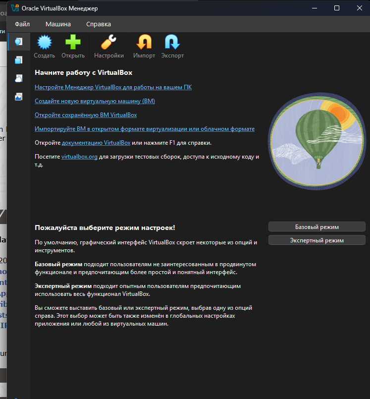

2. **Оптимізація розміщення на SSD:**
   * У системі проаналізовано накопичувачі: диск `C:` (NVMe SSD), диск `D:` (SATA SSD) та диски `E:`, `G:` (HDD).
   * Для забезпечення високої швидкості дискового вводу-виводу (I/O) та збереження вільного місця на системному диску Windows, у глобальних налаштуваннях (*Файл ➔ Настройки ➔ Общие*) шлях до віртуальних машин змінено на швидкий SSD:
     ```text
     D:\VirtualBOX_VMs
     ```

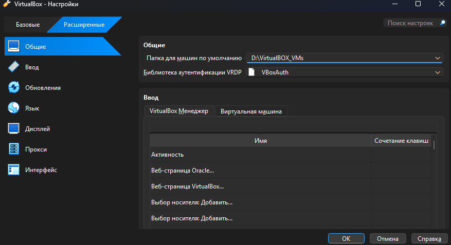

---

## 💻 Етап 2: Створення та конфігурація віртуальної машини `TestVM`

Згідно з вимогами практичного завдання, створено нову віртуальну машину з такими параметрами:
* **Назва:** `TestVM`
* **Тип ОС:** `Linux`
* **Версія ОС:** `Ubuntu (64-bit)`
* **ISO-образ:** `ubuntu-24.04.4-live-server-amd64.iso`
* **Автоматична інсталяція:** вимкнено (*Skip Unattended Installation*), щоб провести чисте ручне встановлення.
* **Оперативна пам'ять (RAM):** `2048 МБ` (2 ГБ).
* **Процесори (CPU):** `2` ядра.
* **Опція EFI:** активовано **`Enable EFI (special OSes only)`** (*Включити EFI*).
* **Жорсткий диск:** новий віртуальний диск розміром **`20,00 ГБ`** у форматі **VDI** (VirtualBox Disk Image), динамічно розширюваний.
* **Мережа:** мережевий адаптер Intel PRO/1000 MT Desktop у режимі **NAT** (з автоматичним отриманням IP через DHCP).

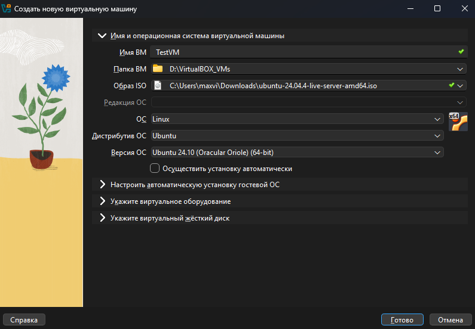

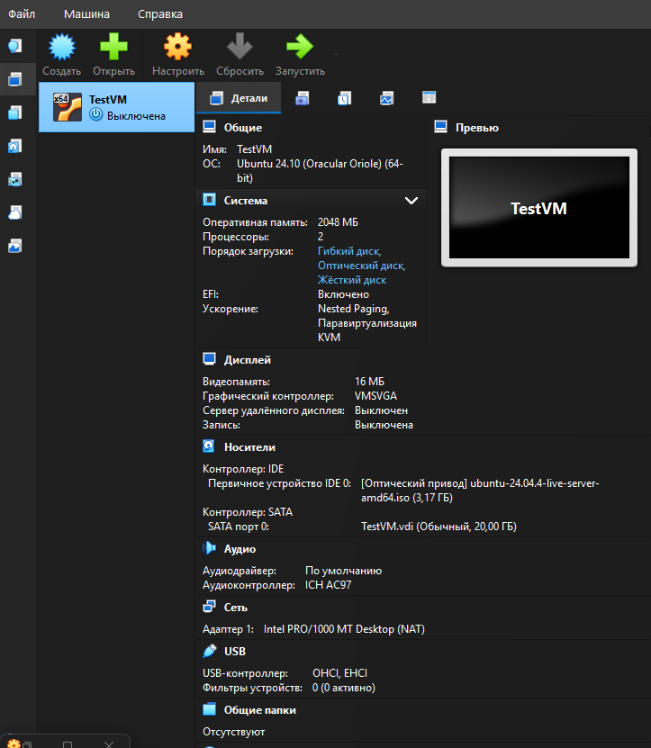

---

## 🚀 Етап 3: Інсталяція Ubuntu Server 24.04 LTS

1. Запущено віртуальну машину та виконано установку Ubuntu Server через Subiquity інсталятор:
   * Мова: `English`, розкладка клавіатури: `English (US)`.
   * Тип установки: `Ubuntu Server`.
   * Мережевий адаптер `enp0s3` автоматично отримав IP-адресу `10.0.2.15/24`.
   * Профіль користувача: логін `devops`, ім'я сервера `testvm`.
   * Активовано прапорець **`[X] Install OpenSSH server`** для забезпечення віддаленого доступу по SSH.
2. Після завершення інсталяції та перезавантаження виконано перший успішний вхід у консоль:

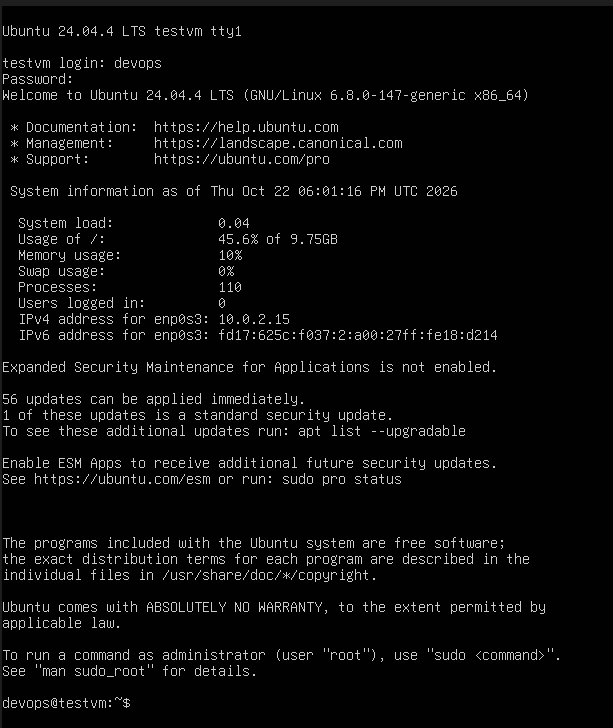

---

## 📸 Етап 4: Робота зі знімками стану (Snapshots) та деструктивне тестування

### 1. Створення знімка «Clean install»
Одразу після першого входу у свіжовстановлену чисту ОС зафіксовано базовий стан системи:
* Меню вікна ВМ: **Машина ➔ Сделать снимок состояния...** (`Host + T`).
* Назва знімка: **`Clean install`**.
* Опис: `Початковий стан після встановлення Ubuntu 24.04 LTS`.

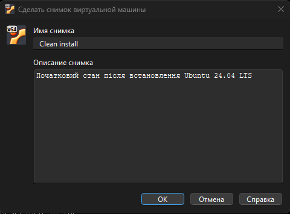

### 2. Внесення тестових змін (деструктивний тест)
Для перевірки роботи механізму відкату у терміналі Ubuntu створено тестову папку та файл із секретними даними:

```bash
mkdir test_folder && echo "test data" > test_folder/secret.txt
ls -la test_folder && cat test_folder/secret.txt
```

* **Аналіз виконаних команд:**
  * `mkdir test_folder` — створення каталогу.
  * `&&` — логічний оператор, який виконує наступну дію лише при успішному завершенні попередньої.
  * `echo "test data" > test_folder/secret.txt` — перенаправлення виводу (`>`) у файл `secret.txt`.
  * `ls -la test_folder` — детальний вивід списку файлів (`-l` розширений формат, `-a` включно з прихованими).
  * `cat test_folder/secret.txt` — зчитування та друк вмісту файлу в консоль.

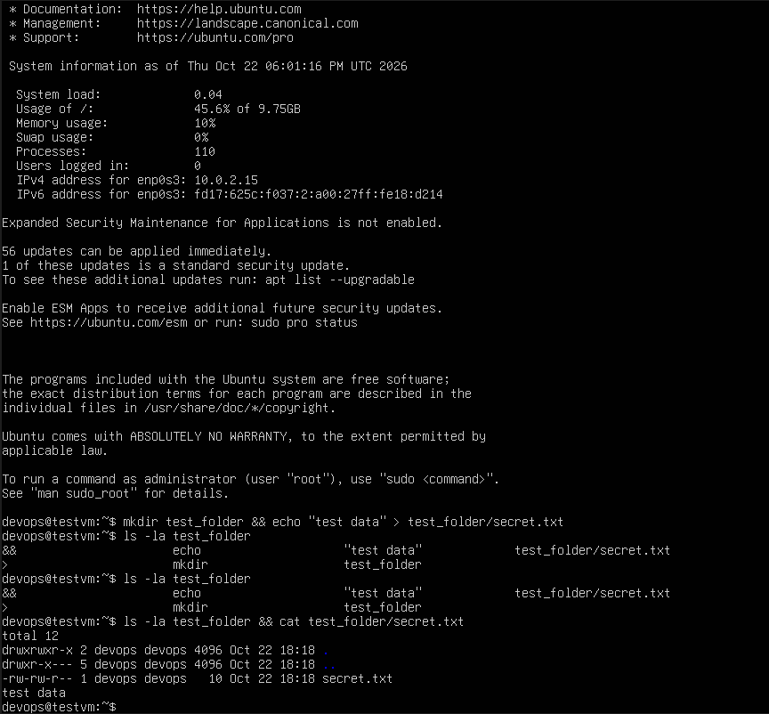

### 3. Відновлення системи зі знімка
1. Вимкнено віртуальну машину командою:
   ```bash
   sudo poweroff
   ```
2. У головному вікні VirtualBox відкрито вкладку **«Снимки»** (*Snapshots*), де відображено дерево станів машини:
   * Базовий знімок `Clean install`.
   * Змінений стан `Текущее состояние (изменено)`.
3. Виділено знімок `Clean install` та натиснуто кнопку **«Восстановить»** (без створення проміжного знімка зміненого стану).

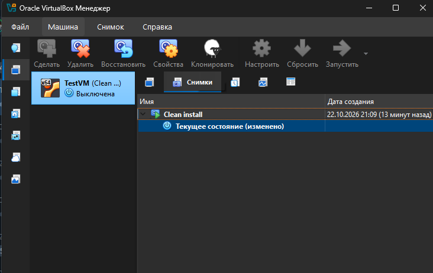

4. Після відновлення віртуальну машину запущено знову. У терміналі виконано перевірку наявності тестової папки:
   ```bash
   ls -la test_folder
   ```
   **Результат:**
   ```text
   ls: cannot access 'test_folder': No such file or directory
   ```
   Всі створені файли повністю та безслідно зникли. Система повернулася до первинного еталону «як після інсталяції». Оскільки знімок робився у ввімкненому стані, VirtualBox зберіг повний стан пам'яті (RAM), тому після відновлення сесія відкрилася миттєво без повторного запиту логіна.

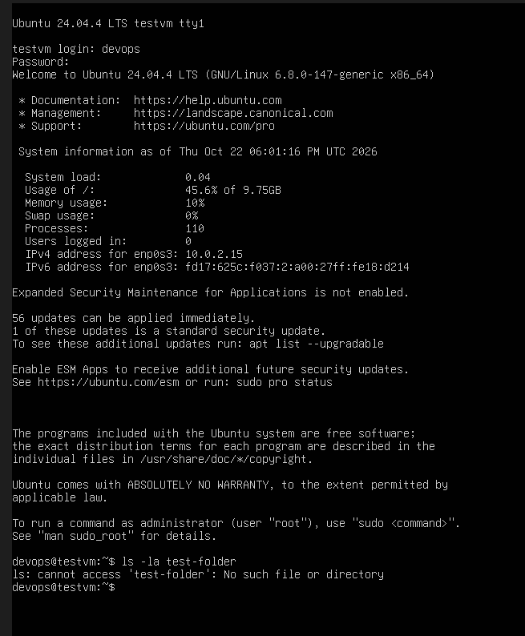

---

## ⚙️ Етап 5: Зміна апаратних параметрів віртуальної машини через GUI

Згідно з інструкцією до завдання, віртуальну машину було вимкнено (`sudo poweroff`) та змінено її ресурси:

1. **Збільшення оперативної пам'яті (RAM):**
   * *Налаштування ➔ Система ➔ Материнська плата*: обсяг пам'яті збільшено з 2048 МБ до **`4096 МБ` (4 ГБ)**.
2. **Збільшення процесорних ядер (CPU):**
   * *Налаштування ➔ Система ➔ Процесор*: кількість ядер збільшено з 2 до **`4` ядер**.
3. **Збільшення віртуального диска:**
   * У глобальному меню *Файл ➔ Інструменти ➔ Менеджер віртуальних носіїв* (`Ctrl + M`) знайдено диск `TestVM.vdi`.
   * За допомогою повзунка розмір диска збільшено з 20,00 ГБ до **`30,00 ГБ`**.

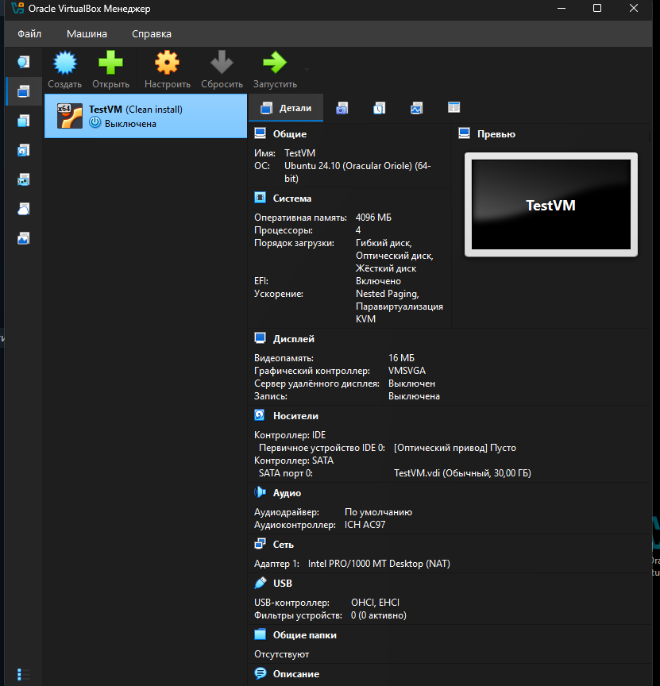

---

## 🔍 Етап 6: Перевірка нового заліза та розширення файлової системи в Ubuntu

1. Після запуску `TestVM` перевірено, як операційна система сприйняла нові ресурси:
   ```bash
   nproc && free -h && lsblk
   ```
   * `nproc` повернув **`4`** ядра CPU.
   * `free -h` показав загальний обсяг оперативної пам'яті **`3.8Gi`**.
   * `lsblk` показав, що фізичний диск `sda` успішно збільшився до **`30G`**.

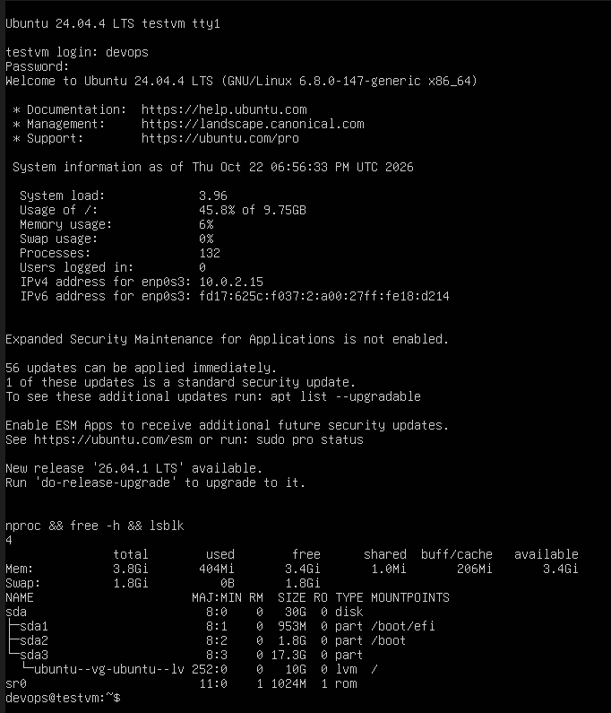

2. **Розширення розділу та файлової системи (LVM):**
   Оскільки диск `sda` збільшився до 30G, але розділ `sda3` та логічний том LVM спочатку займали лише частину простору, виконано послідовне розширення:
   * Розширення фізичного розділу `sda3` за допомогою утиліти `growpart`:
     ```bash
     sudo growpart /dev/sda 3
     ```
   * Оновлення інформації про розмір фізичного тому LVM (Physical Volume):
     ```bash
     sudo pvresize /dev/sda3
     ```
   * Розширення логічного тому LVM (Logical Volume) на 100% вільного місця з автоматичним масштабуванням файлової системи `ext4`:
     ```bash
     sudo lvextend -l +100%FREE -r /dev/ubuntu-vg/ubuntu-lv
     ```
   * Перевірка підсумкового розміру кореневого розділу:
     ```bash
     df -h /
     ```

   **Результат:** Коренева файлова система `/` успішно збільшилася до **`27G`** (вільно `22G` / 82% доступного простору).

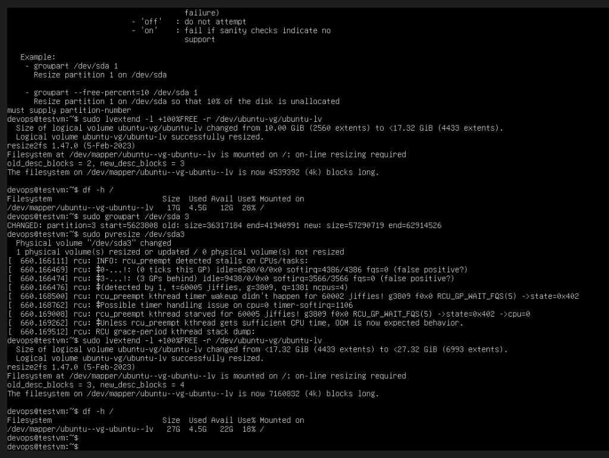

---

## 📝 Висновки та відповіді на контрольні запитання

1. **Як знімок (Snapshot) допоміг відновити початковий стан системи після внесення змін?**
   * Знімок фіксує дерево секторів віртуального диска (VDI) та опціонально стан пам'яті (RAM) на конкретний момент часу. При створенні знімка базовий VDI переходить у режим «тільки для читання», а всі подальші зміни записуються у диференційний образ (differencing disk).
   * При відновленні знімка VirtualBox просто перемикає покажчик активного стану назад на базовий знімок і очищує змінені сектори. Це дозволило миттєво повернути систему у вихідний робочий стан без тривалого перевстановлення ОС чи ручного відновлення конфігурацій.

2. **Як ви змінили параметри VM через інтерфейс VirtualBox та які результати це принесло?**
   * Параметри RAM та CPU було змінено у вікні налаштувань машини (*Система ➔ Материнська плата / Процесор*).
   * Розмір диска було розширено через *Менеджер віртуальних носіїв* (`Ctrl + M`) до 30 ГБ.
   * Усередині ОС Ubuntu було задіяно стандартний стек керування дисками Linux (`growpart` ➔ `pvresize` ➔ `lvextend -r`), що дало змогу без перевстановлення системи та без простою сервісів збільшити корисний дисковий простір з 10 ГБ до 27 ГБ.
